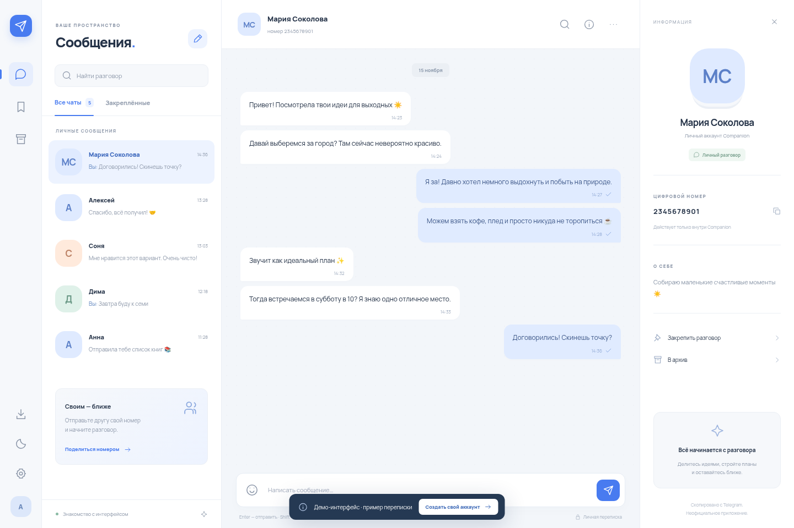
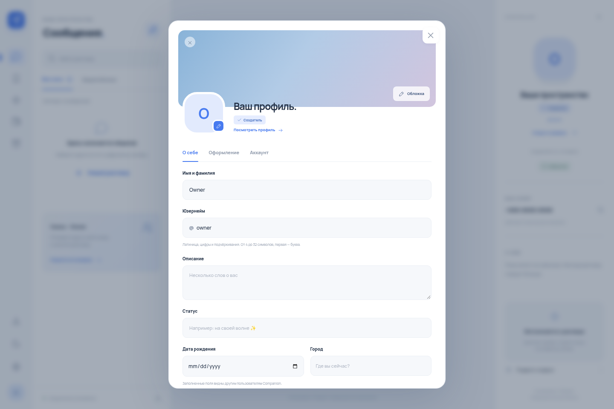
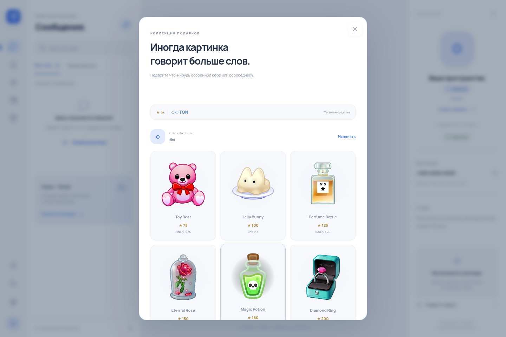

# Companion Messenger

Самостоятельный мессенджер с цифровыми номерами. **Скопировано с Telegram. Неофициальное приложение.** Не подключается к сети Telegram.

[Скачать Windows-версию](downloads/Companion-Windows.zip) · [Настройки GitHub Pages](https://github.com/ipoteca22848/tg/settings/pages)



## Новые профили и подарки





## Что работает

- Регистрация: внутренние номера с префиксами +7, +888, +1, +44 и +49; вход с пробелами и знаком +. Старые 10-значные номера поддерживаются. SIM-карты и SMS не нужны.
- Личные текстовые чаты между устройствами через Supabase.
- Избранное, ответы, эмодзи, редактирование и удаление своих сообщений у обоих участников.
- Поиск по чатам и переписке, закрепление, архив, черновики на устройстве.
- Юзернеймы и поиск по @username. Роль создателя закрепляется в базе, не зависит от имени.
- Профили: фото, обложка, цвет, фон, имя, описание, статус, день рождения, город и смена пароля.
- Магазин 12 подарков с изображениями Telegram, покупка себе/другу, подписи и витрина профиля с настройкой видимости.
- Внутренние тестовые звёзды и TON. У создателя отображается ∞; обычному аккаунту выдаётся 1000 звёзд и 10 тестовых TON.
- Светлая и тёмная темы, адаптация под телефон.
- Установка в отдельное окно как PWA через Chrome / Edge или на домашний экран телефона.

Демонстрационный режим явно помечен и содержит примеры, а не переписку реальных людей.

## Публикация на GitHub Pages

В репозитории: **Settings → Pages → Build and deployment → Source → GitHub Actions**.
Затем запустите workflow **Publish Companion** или отправьте коммит в `main`.

Если GitHub Actions недоступен: **Deploy from a branch → main → /docs → Save**. Папка `docs` уже содержит собранную версию, сборка на сервере не нужна.

Supabase уже настроен отдельно. На GitHub публикуется статический интерфейс, база и авторизация работают в Supabase. Публичные ключи в `src/config.js` предназначены для браузера и не дают административного доступа. Секретный service-role ключ используется только внутри Edge Function через переменную окружения Supabase.

## Разработка

```sh
npm ci
npm test
npm run build
python3 -m http.server 4173 --directory docs
```

Регистрация в браузере разрешена с `https://ipoteca22848.github.io`, а также с loopback-адресов на портах 4173 (разработка) и 8765 (EXE).

Схема и RLS: `supabase/schema.sql`, затем `profile-fields.sql`, `profile-gifts.sql`, `gift-catalog.sql` в папке `supabase`. Регистрация: `supabase/functions/register/index.ts`.

Публичные фото и обложки: bucket `profile-media`, запись только в папку владельца. Поля профиля видны пользователям приложения. Изображения подарков и источники: `docs/gifts/catalog.json`, `docs/gifts/SOURCES.md`.

Роль создателя и номер изменяются только административно. Роль `creator` выдаёт неограниченное использование тестового баланса и защищённый юзернейм `owner`. Пароли аккаунтов не включаются в репозиторий.
Windows EXE: `main.go`; содержит интерфейс и запускает его на http://127.0.0.1:8765. База и авторизация общие, в Supabase. Закрытие окна консоли останавливает локальный интерфейс. Для переписки нужен интернет.

Сборка на Windows: `go build -o Companion.exe main.go` (Go 1.25+).

## Границы версии 0.3

Звёзды и TON здесь — только условные единицы приложения, без денежной стоимости, пополнения за деньги, вывода и блокчейна. Покупка не создаёт подарков Telegram или NFT. Изображения — иллюстрации оригинальных подарков, права на них принадлежат соответствующим правообладателям. Указанные цены условные, не рыночные.

Нет звонков, видеосвязи, групп, каналов, файлов, ботов, уведомлений и сквозного шифрования. Загружаются последние 1000 доступных пользователю сообщений. Обновление переписки каждые 2,5 секунды. Пароль не восстанавливается; сохраняйте его и номер.

Закрепление, архив, тема и черновики хранятся локально на устройстве. Для сообщений нужен интернет. Номера не принимают SMS и не работают в Telegram.

Используются бесплатные тарифы GitHub Pages и Supabase с лимитами провайдеров. Supabase может приостанавливать неактивные бесплатные проекты.

## Проверки

Проверены на действующем сервере: регистрация, вход, доставка, изоляция переписки от третьего пользователя, запрет чужого редактирования и смены получателя, изменение и удаление сообщений. В Chromium проверены desktop/mobile, темы, поиск и обмен сообщениями между двумя сессиями. Windows EXE кросс-компилируется; выполнение на Windows требует отдельной проверки.


Дополнительно проверены: вход с +888, поиск по юзернейму, сохранение фото/даты/цвета/обложки после перезагрузки, RLS для неизменяемых ролей и балансов, покупка за обе тестовые валюты, защита от повторных запросов, недостаточного баланса и подмены получателя.
