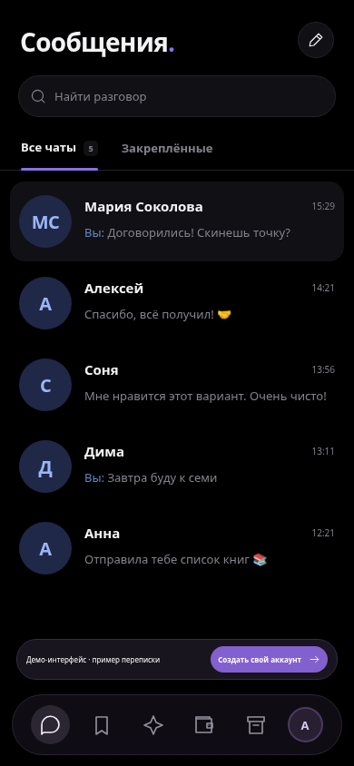
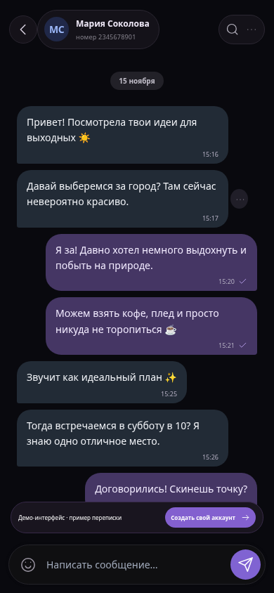
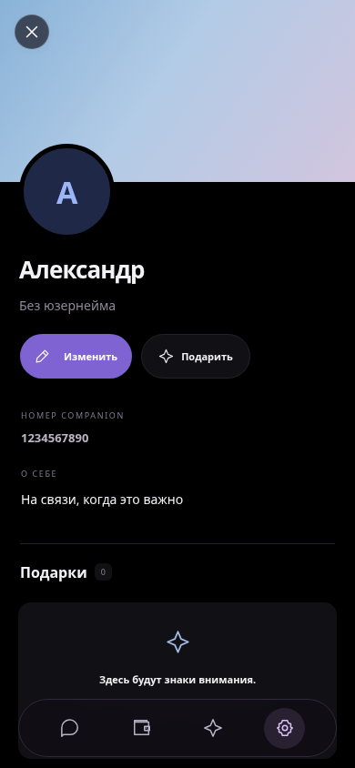

# Companion 0.4 — Windows, Android и сайт

Самостоятельный мессенджер с общими аккаунтами и базой. Оформление чатов и профилей переработано по публичным скриншотам Unixgram из Google Play: чёрная тема, фиолетовые акценты, круглые аватары, плавающая нижняя панель и скруглённые элементы чата. Это Companion, не официальный Unixgram и не клиент Telegram.

[Windows](downloads/Companion-Windows.zip) · [Android APK](downloads/Companion-Android.apk) · [Код для хостинга сайта](downloads/Companion-Website-Source.zip)

## Установленные приложения

**Windows x64:** распакуйте ZIP и запустите `Companion.exe`. Мессенджер открывается в собственном окне WebView2. EXE не запускает HTTP-сервер, не слушает локальный порт и не открывает вкладку браузера. Нужен Windows 10/11 с Microsoft Edge WebView2 Runtime. Ресурсы интерфейса встроены; авторизация и сообщения идут прямо в Supabase. Сессия сохраняется в профиле приложения. Закрытие окна завершает приложение.

**Android 8+:** скачайте APK и установите с разрешением установки из выбранного источника. Интерфейс встроен в APK и работает в Android WebView. Приложение не запускает локальный сервер и не требует открытого браузера или запущенного сайта. Есть системный выбор изображения для фото/обложки, работа кнопки «Назад» и копирование в буфер. Для сообщений нужен интернет и актуальный Android System WebView.

APK — подписанная сборка для установки вручную. Для Google Play используйте собственный release-ключ и требования магазина. Ключи подписи не включены в публичный репозиторий. Для обновлений используйте один и тот же keystore; при другой подписи Android потребует удалить старое приложение.

## Скриншоты интерфейса

Ниже используются только вымышленные данные демонстрационного режима.

## Что работает

- Регистрация с префиксами +7, +888, +1, +44, +49. Все номера — внутренние идентификаторы, не SIM-карты; SMS не принимаются. Старые номера поддерживаются.
- Вход по номеру и паролю, юзернеймы, поиск человека по номеру или @username.
- Личные текстовые чаты, история, избранное, поиск, ответы, эмодзи, изменение и удаление своих сообщений.
- Закрепление, архив, локальные черновики, светлая/тёмная тема.
- Профиль: фото, обложка, имя, юзернейм, описание, статус, цвет, фон, день рождения, город, смена пароля.
- 12 подарков с изображениями Telegram, покупка себе или другу, подпись и витрина с настройкой видимости.
- Тестовые звёзды и TON: обычному аккаунту выдаются 1000 звёзд и 10 тестовых TON. Роль создателя даёт безлимитное использование этих единиц и юзернейм @owner; роль не меняется через профиль.

Звёзды и TON здесь не имеют денежной стоимости, не выводятся и не являются криптовалютой или Telegram Stars. Покупка не создаёт Telegram-подарок или NFT. Изображения принадлежат их правообладателям, источники указаны в `docs/gifts/SOURCES.md`. Паролей аккаунтов в репозитории нет.

## Код сайта и backend

[Инструкция для хостинга](host/README.md). Загрузите содержимое `docs/` на HTTPS-хостинг либо выполните `docker compose up -d --build` на VPS.

Сайт — отдельный способ доступа к тому же мессенджеру. Он не требуется установленным клиентам. Общий backend находится в вашем Supabase-проекте `companion-messenger`. SQL, RLS и Edge Function доступны в `supabase/`.

Конфигурация публичного клиента — `docs/companion-config.js`. Это URL, publishable key и публичный anon JWT. Service-role ключ туда помещать нельзя. Для другого Supabase-проекта замените публичные параметры до сборки клиентов.

GitHub Pages по-прежнему нужно включить владельцу в Settings → Pages → Source → GitHub Actions. Затем запустите Publish Companion. Текущий подключённый доступ не позволяет создать Pages site (HTTP 403). До включения Pages пользуйтесь установленными приложениями или своим хостингом.

## Сборка

Веб-интерфейс: Node.js 22+, `npm ci`, `npm test`, `npm run build`.

Windows: Go 1.25+, на Windows `go build -trimpath -ldflags="-s -w -H windowsgui" -o Companion.exe .`. Для кросс-компиляции задайте `GOOS=windows`, `GOARCH=amd64`. Зависимости закреплены в `go.mod`/`go.sum`.

Android: JDK 21+, официальный Android SDK с `platforms;android-35` и `build-tools;35.0.0`. Запустите `scripts/build-android.py`, задав `ANDROID_SDK_ROOT` и `COMPANION_KEYSTORE`. Gradle и сторонние Android-библиотеки не требуются. При отсутствии keystore скрипт создаёт development-ключ вне исходников; для публикации доработайте подпись под собственный release-процесс.

## Проверено и ограничения

APK собран, подписи v2/v3 проверены Android apksigner; manifest проверен aapt2. Windows EXE собран как GUI executable. В Chromium проверены вход, восстановление сессии, профили, подарки, мобильная компоновка и оба виртуальных HTTPS-origin установленных клиентов. Нативный запуск APK на Android и EXE на Windows в этой Linux-среде не выполнялся.

Серверные проверки предыдущей версии: изоляция переписки, ограничения ролей и балансов, списание обеих тестовых валют, недостаточный баланс, идемпотентность покупки и видимость подарков.

Это не полная функциональная копия Unixgram или Telegram: нет ленты, историй, звонков, групп, каналов, вложений, фоновых push-уведомлений, восстановления пароля и сквозного шифрования. Загружаются последние 1000 доступных сообщений, обновление — каждые 2,5 секунды. Фото и обложки доступны по публичным ссылкам. Бесплатные тарифы провайдеров имеют лимиты.

Скопировано с Telegram. Неофициальное приложение. Дизайн по визуальному образцу Unixgram; приложение не связано с этими сервисами.
